# Keypad GCM investigation — issue #1

CTR is the default. The optional `keypad_crypto_mode: gcm_experimental` setting
enables a bench mode for standalone Keypad Touch 3.1 action sessions.
It uses the saved keypad association and the bounded flow described below.

SwitchBot bulletin [ORSA-2026-002](https://www.switcbot.live/pages/security-bulletins)
lists Keypad Touch **2.9** as the first fixed firmware and names AES-GCM, unique
nonces, and verification before executing commands as parts of the fix. The
bulletin gives no BLE frame layout, tag length, or direction-specific counter
rules. A successful CTR unlock against this bridge does not identify the
keypad's firmware or rule out support for another mode.

On the test ESP32-C3, the boot primitive self-test and BLE advertising passed.
The dedicated Keypad Touch paired, then sent two successful CTR fingerprint
unlocks. The runtime handshake request was eight bytes. The bridge selected
CTR and sent a twenty-byte session reply. The keypad firmware was not present
in those logs. For the GCM experiment, record its version from the SwitchBot app.

The updated boot diagnostic also prints `GCM tag-prefix self-test: PASS/FAIL`.
It checks the reference framing's two-byte prefix using a public AES-GCM vector
and checks that a modified tag or ciphertext is rejected and the output buffer
cleared. Both GCM self-tests passed on the physical C3 after OTA. This tests
the primitive and prefix checking, independent of keypad negotiation.

The test Keypad Touch was initially on 2.5 with no update offered in the app.
The app showed a keypad-first prerequisite for an available lock update. In
this setup, associating the dedicated keypad with that lock and reopening the
lock update flow made the keypad update available. The test keypad now reports
**3.1**. This is an observation for this setup, not a general rollout rule.

The user then paired the dedicated 3.1 keypad back to the standard bridge and
confirmed that it works. The standard bridge serves CTR at runtime, so this
establishes the CTR compatibility baseline on 3.1. There is no provisioning
mode log from that run, and no reason to repeat pairing just for the log.

The wizard now logs `Keypad provisioning handshake: mode=... response_length=...`
and stops on modes other than CTR before provisioning writes. This measures the
updated keypad acting as a BLE server during association. The later runtime
test still needs to verify its separate role as a BLE client to the bridge.

## What to run now

The temporary development environment prepared in this session is:

```sh
/private/tmp/switchbot-esphome-venv/bin/python tools/keypad_gcm_lab.py doctor
/private/tmp/switchbot-esphome-venv/bin/python tools/keypad_gcm_lab.py selftest
/private/tmp/switchbot-esphome-venv/bin/python -m unittest discover -s tests -p 'test_*.py'
sh tests/run_lock_session_tests.sh
sh tests/run_keypad_state_tests.sh
```

To recreate it elsewhere, use Python 3.12 or another version supported by the
chosen ESPHome release, create a venv, and install ESPHome and
`tools/requirements-gcm.txt`. The doctor reports modules and serial ports; it
does not claim that Bluetooth permissions or a BLE sniffer are available.

## First hardware test: baseline, using the project itself

Prerequisites: identify the actual ESP32 board, keypad model/firmware and whether
a physical lock is present. Keep the existing board/network/API/OTA settings.
Do not flash the supplied XIAO example onto a different board.

`switchbot-keypad-bridge.diagnostics.yaml` inherits the existing XIAO ESP32-S3
example, reads root `secrets.yaml`, and uses the published investigation branch.
For uncommitted local changes, pass `-s bridge_component_source components` to
ESPHome. The normal example downloads upstream and would therefore
not exercise this investigation's changes. For another board, apply the same
local-source and logger overrides to its existing working configuration.

After the board configuration is confirmed:

```sh
esphome compile switchbot-keypad-bridge.diagnostics.yaml
esphome run switchbot-keypad-bridge.diagnostics.yaml
esphome logs switchbot-keypad-bridge.diagnostics.yaml
```

Perform these steps and label their timestamps in the result:

1. Start logs; reboot the ESP32 using its reset/power button. Record the
   `GCM primitive self-test: PASS/FAIL` line. This exercises the ESP32's actual
   GCM backend with a public fixed key/vector, without using saved keys. Do NOT press the
   bridge's Home Assistant **Reset** entity: that entity rotates saved keys.
2. Use one existing credential once. Record success/failure and the HA event.
3. Wait 25 seconds; use the same credential again. Record the result.
4. If Vision face/palm is configured, repeat using that method, then press Lock.
5. Power-cycle only the keypad and repeat one credential operation.
6. If a physical lock is already linked, record its advertised crypto mode and
   whether the relay actually operates the lock. Do not link/reset merely for
   this baseline.

Collect only session/connection/mode/error lines and event counts. Redact device
names, addresses and credential indices from other log lines before sharing.
The new session logs contain lengths/context labels instead of plaintext,
ciphertext or IV dumps. Baseline success means the local build preserves CTR
behavior; it provides NO evidence that the keypad accepts GCM.

For Home Assistant Device Builder, follow [the Italian step-by-step guide](test-da-ha.md)
to update the existing device YAML while preserving its board/network settings.

## Routes to resolve the GCM unknowns

### A. Source evidence first — no additional hardware

Compare the exact current client implementations with deterministic generated
messages. The lab already checks real AES-GCM against a known-answer vector,
the two-byte prefix, bit mutations, wrong key/nonce, and three candidate nonce
schedules. Synthetic tests establish the analyzer's behavior, not firmware rules.

References:

- [pySwitchbot device](https://github.com/sblibs/pySwitchbot/blob/main/switchbot/devices/device.py)
- [pySwitchbot tests](https://github.com/sblibs/pySwitchbot/blob/main/tests/test_encrypted_device.py)
- [OpenSB crypto](https://github.com/MyrikLD/opensb/blob/main/packages/opensb-core/src/opensb/ble/crypto.py)
- [OpenSB session](https://github.com/MyrikLD/opensb/blob/main/packages/opensb-core/src/opensb/ble/session.py)

### B. Existing ESP32 plus a GCM physical lock — preferred hardware route

The opt-in `gcm_diagnostics: true` setting opens the wizard during startup even
with an existing keypad association. Sign in, open **Locks**, and click
**Test session** on a nearby updated lock from your account. The original
version requested only the session announcement. The current version also
sends one read-only lock-info query when the lock announces GCM. It uses the
account slot and communication key supplied by SwitchBot for that lock.
It logs the response status, header byte 1, length, and whether the two-byte
tag matches at `N`, `N+1`, or `N+2`. It never logs the nonce, key or payload
for the diagnostic. This measures a genuine lock response to an account-slot
query. It does not prove that the keypad slot uses the same rules.

On 22 November 2026 the user ran the probe three times against the same
updated lock. Each reply had status `0x01`, mode `0x01`, length 20, and an
all-zero trailer. The probe did not record bytes 1 and 3 or establish whether
this format is shared across lock models or key slots.

The follow-up **Test keypad GCM** button in the diagnostic wizard arms a
30-second standalone test. For an exact eight-byte Touch session request on
its existing slot, the bridge sends the reference header, a fresh 12-byte
nonce and the observed zero trailer. Header bytes 1 and 3 use the client
reference values. The probe checks at most one incoming frame using that
initial nonce and the reference two-byte tag format. It publishes no keypad
actions during the window and sends no encrypted command reply. The next
session after the window uses CTR. A match supports the initial request
format; further work is needed to verify reply and counter rules.

The dedicated Keypad Touch 3.1 connected to the ESP32-C3 and sent a 12-byte
frame after the bridge advertised mode `0x01`, length 20 and an all-zero
trailer. The two-byte tag prefix matched with the initial nonce and the
existing association key. This is observed evidence for the first keypad to
bridge frame. The diagnostic sent no encrypted response, so this run does not
establish either reply nonce selection or subsequent command progression.

The second version of **Test keypad GCM** sent one synthetic unlock response
only after the first frame has a matching tag and decodes to an unlock. It uses
the existing Touch response payload and the `N+1` reply hypothesis from the
physical lock client. It then measures the first follow-up on that connection
at `N`, `N+1` and `N+2`. It logs the matches and whether `N+2` yields a state
poll. The probe never sends a second encrypted reply. A match at `N+1` could
indicate reuse of the nonce used for the diagnostic reply; this is a bench
experiment, and its counter schedule is not used for normal unlocks.

The Keypad Touch 3.1 sent a 12-byte unlock at `N`, then an eight-byte frame
after the bridge sent a nine-byte reply encrypted at `N+1`. The eight-byte
frame's tag prefix matched at `N+1` only. This is evidence of nonce reuse in
that experiment. It does not establish that the keypad accepted the reply,
because it may send the follow-up independently.

The no-reply diagnostic withheld the encrypted reply and still checked the
first follow-up at `N`, `N+1` and `N+2`. It also reports whether a matching
frame at `N+1` or `N+2` decodes as a state poll. This isolates the effect of
the reply using the existing Keypad Touch association.

In the no-reply run the first 12-byte frame matched at `N`. The keypad
disconnected two seconds later and no follow-up arrived within the test window.
In the prior run with a reply, it sent an eight-byte follow-up about one second
later. This comparison supports the reply affecting the keypad's progression;
it does not establish a safe response nonce. The user also observed a blinking
green padlock. The exact indicator and sound sequence was not captured.

The follow-up diagnostic now sends exactly one reply at `N+2`. This changes
only the reply nonce compared with the earlier `N+1` test. The keypad frames
observed earlier used `N` and `N+1`, so `N+2` tests a distinct reply nonce for
this exchange. A valid state poll at `N+1` would support compatibility for
the first reply. It would not establish a safe schedule for longer sessions,
since the keypad might use `N+2` later. A follow-up at `N+2` would be another
nonce collision. A timeout would rule out this reply format for this run and
leave the genuine SwitchBot response format as the next evidence to collect.

The Keypad Touch 3.1 sent a valid state poll at `N+1` after the `N+2`
reply. Neither `N` nor `N+2` matched the poll. The next diagnostic answers
that poll once at `N+3` with the existing unlocked-state payload. It then
observes a third frame, a new handshake or a disconnect. If a third frame
matches `N+2` or `N+3`, the proposed schedule collides and must stay out of
normal mode. A disconnect with no third frame bounds the observed exchange to
four distinct nonce values. The keypad's LED or beep may provide additional
evidence of its reaction to the final reply.

On Keypad Touch 3.1 the second reply was sent at `N+3`. The keypad disconnected
two seconds later with no third frame observed. The user heard two beeps and
saw the padlock stop blinking. This confirms the observed end of the exchange,
but the beeps alone do not confirm how the keypad interpreted the last reply.

For an event test on the paired standalone keypad, add this option beneath
`switchbot_keypad_bridge:` and install via OTA:

```yaml
keypad_crypto_mode: gcm_experimental
```

Press one enrolled fingerprint and check for `GCM experimental unlock` in the
ESPHome logs and the usual `Unlock` entity event in Home Assistant. Try again
after the first disconnect. The custom event still uses the existing HA device
permission and carries `method` and `index`.

The first on-device GCM event trial published a fingerprint unlock at index 0.
The two subsequent GCM frames had matching tags and were rejected by the
fingerprint-only build. The next build accepts Touch PIN, NFC and fingerprint
unlock commands, and the keypad's Lock command. Test each method separately
and record both the event result and any red or blinking keypad indicator.
The event confirms what the bridge processed. It cannot confirm how the
keypad interpreted the reply or its own indicator when the action ends.

The user confirmed a red LED at the end of a repeated fingerprint attempt.
The bridge-side unlock event and the keypad's visible outcome are separate
acceptance criteria. Use the genuine lock reply data as the next reference
before changing the response format or calling fingerprint operation reliable.

The subsequent read-only query to the updated physical lock used the account
key and initial nonce `N`. The reply had status `0x01`, header byte 1 `0xE8`,
and length 20. Its two-byte tag prefix matched at `N` only. This is evidence
of the same key and nonce being used in both directions for that particular
account-slot exchange. The request slot was not logged, so this capture does
not establish whether byte 1 is an echo of it. Neither finding establishes
the nonce or header rules on the dedicated keypad slot. Mirroring `N` for
the bridge's keypad reply would reuse the nonce already used by the keypad
to encrypt its first command.

The [public Keypad BLE API](https://github.com/OpenWonderLabs/SwitchBotAPI-BLE/blob/latest/devicetypes/keypad.md)
documents advertisements, not the paired GCM exchange. A useful vendor
reference would give the response header, wire tag length, nonce rule and
whether the two directions use separate keys on the keypad pairing slot. Ask
for a worked fingerprint unlock plus state-poll exchange or synthetic vectors.
The CTR baseline is available with the existing pairing while this is pending.

A local alternative uses a spare lock on the bench. `LockLinker` already
provisions the bridge's shared key into slot `0x88` for a Touch-family keypad.
On that spare lock only, use the existing provisioning flow once, then run the
read-only status probe on the shared slot instead of the account slot. Report
the mode, response header, size, and tag match at each candidate nonce. This
changes the key slot on the spare lock, so it must not be run on a lock in use.
The result isolates the slot difference from the account probe. It is still a
state query, not proof of the original fingerprint reply semantics.

Before changing the installed lock's slot, **Test session** now runs a
configuration-preserving preflight on the same lock. It compares the two
account-slot status replies in one GCM session, sending the second request
at `N+1` only if the first reply matched uniquely at `N`. It reports whether
the reply echoes the requested slot. It then requests just a session
announcement for the keypad slot. The keypad-slot probe uses no key and sends
no encrypted command. The announcement reveals which mode the lock advertises
for that slot, but cannot establish response authentication on it.

The old lock-link provisioning path reused the initial GCM nonce on each of
its key-slot writes and used an unverified reply counter. It now stops before
the first write if the lock negotiates GCM for that multi-command sequence.
Do not interpret a successful status preflight as permission to use the old
provisioning behavior on an installed lock.

The preflight on the installed lock produced two 20-byte account replies
with `slot_echo=yes` and `tag_offsets=1`. The value is a bit mask, so both
replies matched at offset zero from their own request nonce, first `N` and
then `N+1`. A direct announcement request to slot `0x88` returned a four-byte
reply with status `0x02`. This does not identify the reason for rejection or
the slot used by the lock's existing keypad.

The next read-only probe records the selector byte from an authenticated
state poll sent by the dedicated keypad to the C3. It uses that identical
query on the account slot as the second read, after the initial lock-info
reply matches. It reports length and a structural check against the legacy
14-byte keypad state body, without logging decrypted bytes. This compares the
query itself independently of the slot change. It cannot prove the original
keypad-slot response nonce.

The genuine lock answered that query with 18 wire bytes and a tag match at
offset zero. The 14-byte state body did not match the legacy structural check.
The reference-reply test keeps an authenticated body in RAM for two minutes.
Explicitly arming **Test keypad with lock reply** applies that body to a single
subsequent fingerprint exchange, using the same `N+3` nonce as the synthetic
poll reply. It suspends events for that exchange. Read the reference while the
physical lock is unlocked so that the snapshot reflects the intended state.
The observed keypad indication is the result. No change in indication would
leave reply nonce, unlock reply content and slot-specific semantics open.

The experimental mode allows one exchange on a single BLE connection. It
checks both two-byte tag prefixes, the known frame sizes and command sequence,
and publishes the action event only after the poll reply was sent and
the same connection disconnected within ten seconds without a third frame.
It rejects unexpected frames, has a shared limit of three rejected exchanges
per 60-second window, and handles neither a linked physical lock nor a CTR
fallback. The limit is in RAM and can deny service to a legitimate user. A
16-bit tag remains a protocol limit. Use the mode for event testing rather
than as the authorization boundary for a real door. Remove the option or set
`keypad_crypto_mode: ctr` to restore the original path with the saved pairing.

A lock session response supplies real handshake bytes. Whether these can be
served to a keypad, and whether a transparent central/peripheral relay can
maintain a working conversation, still require a separate instrumented test.
Do not claim an ordinary ESP32 can passively capture unrelated BLE connections.
Do not send actuator commands just to explore nonce behavior.

### C. Only ESP32 plus keypad

Baseline and the diagnostic YAML's on-device primitive test are available without a genuine lock.
A keypad may also be interrogated as a peripheral using the existing pairing
transport, but its server behavior need not match its client behavior towards a
lock. Without trustworthy handshake bytes and nonce rules, do not advertise an
invented GCM handshake. If source/device evidence cannot close those gaps, a
compatible lock or a trusted capture is the actual dependency, not more logging.

### D. External BLE capture — fallback

Use a compatible BLE sniffer and Wireshark to observe a working keypad/lock
session. First verify supported PHY, connection-following and any BLE link
encryption; radio capture alone does not guarantee readable application frames.
Select the equipment only after identifying actual models/firmware. A phone's
HCI log records that phone's own connections, not automatically keypad-to-lock
traffic. Keep captures and any analysis keys private.

## Frame map and unresolved fields

| Exchange | Established from code/client references | Still needs keypad evidence |
| --- | --- | --- |
| Session request | `57 00 00 00 0F 21 03 slot` | extensions/retries on updated firmware |
| CTR reply | `01 00 00 00` + 16-byte IV | existing behavior only |
| GCM reference reply | `01 00 01 00` + 12-byte nonce + 4 trailing bytes | meaning/value rules of trailing bytes |
| GCM encrypted command | 4-byte header; bytes 2–3 are tag prefix | direction rules, header binding/AAD, slot policy |
| GCM response | client implementations differ in nonce handling | actual response nonce and subsequent progression |
| Vision rotation | CTR uses active/pending/retired contexts | GCM rotation/retry/reconnect semantics |

Current roles are distinct: KeypadPairer provisions a keypad as a BLE client;
LockSession serves runtime keypad requests; PhysicalLockClient calls a genuine
lock. Copying one role does not establish another's state machine.

```mermaid
stateDiagram-v2
    [*] --> NoSession
    NoSession --> PendingCTR: current handshake
    PendingCTR --> ActiveCTR: accepted command under pending IV
    ActiveCTR --> PendingCTR: next handshake; existing overlap rules
    NoSession --> GCMBlocked: GCM requested by future explicit opt-in
    GCMBlocked --> PendingGCM: only after layout and nonce rules verified
    PendingGCM --> ActiveGCM: tag + slot + state validation
    ActiveGCM --> ActiveGCM: verified exchange; proven nonce progression
    ActiveGCM --> NoSession: invalidated session / key reset
```



GCM states above are intended design, not implemented production behavior.
CTR has additional predecessor handling documented in `lock_session.h`.

## Offline trace analyzer (when private evidence is available)

Store a 16-byte hex key in a private file outside the repository. Store one
handshake and complete alternating request/reply exchanges in another private
file, for example this structure (placeholders are not executable test data):

```json
{
  "handshake": "<20 bytes hex>",
  "frames": [
    {"direction": "request", "wire": "<complete frame hex>"},
    {"direction": "reply", "wire": "<complete frame hex>"}
  ]
}
```

```sh
python tools/keypad_gcm_lab.py analyze /private/tmp/private-trace.json --key-file /private/tmp/private-key.hex
```

The tool prints match counts only for candidate (request stride, reply offset)
of (1,0), (1,1), (2,1), assuming empty AAD. A match is not automatic protocol
selection. The report shows matches for each direction and counts repeated
nonces among matching frames. It also classifies the handshake trailer as
all-zero or nonzero without printing the bytes. In particular (1,0) reuses the nonce across directions and (1,1)
overlaps a reply nonce with the following request. These candidates are useful
for detecting protocol limitations, not approval to encrypt distinct plaintexts
with the same key/nonce. Four trailing bytes are deliberately uninterpreted.
Split at each new handshake; losses, retries, empty ACKs, errors and rotation
need dedicated handling rather than silently being fitted to this first model.

The all-zero trailer in the pySwitchbot unit tests is synthetic. Both the
pySwitchbot and OpenSB client parsers discard the trailer from GCM replies.
For the runtime experiment on Keypad Touch 3.1, start with a genuine GCM
handshake reply from a compatible SwitchBot lock and compare several replies
across fresh sessions before deciding what the bridge may generate. The
minimum evidence for evaluating the candidate nonce progression is two
consecutive encrypted request/reply pairs from a single session. A setup
handshake with the keypad acting as a BLE server cannot validate the keypad's
runtime behavior when it acts as the client.

The wire tag has only 16 bits. Repeated matching exchanges strengthen an
hypothesis but do not establish 128-bit authentication. This tool does not test
server slot validation, replay rejection, events, relay gating or ESP32 crypto.

## Completion gates

1. Local tests and board compilation pass; existing association still works.
2. Real updated-device evidence explains handshake tail and nonce progression.
3. GCM server accepts one poll/unlock and successive actions without nonce reuse.
4. Negative validation demonstrably emits no event and performs no relay.
5. Reconnect/rotation/Vision matrix passes for named models and firmware.
6. Explicit opt-in, no downgrade, accurate security documentation, PR into fork.

An unresolved nonce-reuse rule is a blocker to the issue's acceptance criteria,
even if an experimental exchange appears compatible.

## Actual validation in this checkout

Environment: temporary Python 3.12 venv, ESPHome 2026.10.2, cryptography 50.0.2.

- `python tools/keypad_gcm_lab.py selftest`: PASS, real host AES-GCM.
- `python -m unittest discover -s tests -p 'test_*.py'`: PASS, 5 tests.
- `sh tests/run_lock_session_tests.sh`: PASS (session logic with mocked CTR).
- `sh tests/run_keypad_state_tests.sh`: PASS.
- Diagnostic YAML validation: PASS in a temporary copy with example secrets and
  an absolute path to this checkout's component; includes boot self-test call.
- `python -m esphome compile tests/compile.wt32-eth01.yaml`: PASS with the new
  self-test method and API action; firmware size 965615 bytes, RAM 41676 bytes.
- Device flashing, ESP32 self-test execution, keypad compatibility and physical
  lock experiments: NOT RUN. No attached ESP32 serial port was detected.

The compiled WT32 firmware uses the test configuration and is not a replacement
for a user's device configuration. Confirm the board before preparing its image.
