# Keypad GCM investigation — issue #1

Status: investigation tooling only. No GCM server handshake is advertised yet.
CTR and existing saved associations remain in use. No key export or rotation is
needed for the first test. Firmware compilation is distinct from hardware testing.

SwitchBot bulletin [ORSA-2026-002](https://www.switcbot.live/pages/security-bulletins)
lists Keypad Touch **2.9** as the first fixed firmware and names AES-GCM, unique
nonces, and verification before executing commands as parts of the fix. The
bulletin gives no BLE frame layout, tag length, or direction-specific counter
rules. A successful CTR unlock against this bridge does not identify the
keypad's firmware or rule out support for another mode.

On the test ESP32-C3, the boot primitive self-test and BLE advertising passed.
The dedicated Keypad Touch paired, then sent two successful CTR fingerprint
unlocks. The runtime handshake request was eight bytes. The bridge selected
CTR and sent a twenty-byte session reply. The keypad firmware was not present
in those logs. For the GCM experiment, record its version from the SwitchBot app.

The updated boot diagnostic also prints `GCM tag-prefix self-test: PASS/FAIL`.
It checks the reference framing's two-byte prefix using a public AES-GCM vector
and checks that a modified tag or ciphertext is rejected and the output buffer
cleared. Both GCM self-tests passed on the physical C3 after OTA. This tests
the primitive and prefix checking, independent of keypad negotiation.

The test Keypad Touch was initially on 2.5 with no update offered in the app.
The app showed a keypad-first prerequisite for an available lock update. In
this setup, associating the dedicated keypad with that lock and reopening the
lock update flow made the keypad update available. The test keypad now reports
**3.1**. This is an observation for this setup, not a general rollout rule.

The wizard now logs `Keypad provisioning handshake: mode=... response_length=...`
and stops on modes other than CTR before provisioning writes. This measures the
updated keypad acting as a BLE server during association. The later runtime
test still needs to verify its separate role as a BLE client to the bridge.

## What to run now

The temporary development environment prepared in this session is:

```sh
/private/tmp/switchbot-esphome-venv/bin/python tools/keypad_gcm_lab.py doctor
/private/tmp/switchbot-esphome-venv/bin/python tools/keypad_gcm_lab.py selftest
/private/tmp/switchbot-esphome-venv/bin/python -m unittest discover -s tests -p 'test_*.py'
sh tests/run_lock_session_tests.sh
sh tests/run_keypad_state_tests.sh
```

To recreate it elsewhere, use Python 3.12 or another version supported by the
chosen ESPHome release, create a venv, and install ESPHome and
`tools/requirements-gcm.txt`. The doctor reports modules and serial ports; it
does not claim that Bluetooth permissions or a BLE sniffer are available.

## First hardware test: baseline, using the project itself

Prerequisites: identify the actual ESP32 board, keypad model/firmware and whether
a physical lock is present. Keep the existing board/network/API/OTA settings.
Do not flash the supplied XIAO example onto a different board.

`switchbot-keypad-bridge.diagnostics.yaml` inherits the existing XIAO ESP32-S3
example, reads root `secrets.yaml`, and uses the published investigation branch.
For uncommitted local changes, pass `-s bridge_component_source components` to
ESPHome. The normal example downloads upstream and would therefore
not exercise this investigation's changes. For another board, apply the same
local-source and logger overrides to its existing working configuration.

After the board configuration is confirmed:

```sh
esphome compile switchbot-keypad-bridge.diagnostics.yaml
esphome run switchbot-keypad-bridge.diagnostics.yaml
esphome logs switchbot-keypad-bridge.diagnostics.yaml
```

Perform these steps and label their timestamps in the result:

1. Start logs; reboot the ESP32 using its reset/power button. Record the
   `GCM primitive self-test: PASS/FAIL` line. This exercises the ESP32's actual
   GCM backend with a public fixed key/vector, without using saved keys. Do NOT press the
   bridge's Home Assistant **Reset** entity: that entity rotates saved keys.
2. Use one existing credential once. Record success/failure and the HA event.
3. Wait 25 seconds; use the same credential again. Record the result.
4. If Vision face/palm is configured, repeat using that method, then press Lock.
5. Power-cycle only the keypad and repeat one credential operation.
6. If a physical lock is already linked, record its advertised crypto mode and
   whether the relay actually operates the lock. Do not link/reset merely for
   this baseline.

Collect only session/connection/mode/error lines and event counts. Redact device
names, addresses and credential indices from other log lines before sharing.
The new session logs contain lengths/context labels instead of plaintext,
ciphertext or IV dumps. Baseline success means the local build preserves CTR
behavior; it provides NO evidence that the keypad accepts GCM.

For Home Assistant Device Builder, follow [the Italian step-by-step guide](test-da-ha.md)
to update the existing device YAML while preserving its board/network settings.

## Routes to resolve the GCM unknowns

### A. Source evidence first — no additional hardware

Compare the exact current client implementations with deterministic generated
messages. The lab already checks real AES-GCM against a known-answer vector,
the two-byte prefix, bit mutations, wrong key/nonce, and three candidate nonce
schedules. Synthetic tests establish the analyzer's behavior, not firmware rules.

References:

- [pySwitchbot device](https://github.com/sblibs/pySwitchbot/blob/main/switchbot/devices/device.py)
- [pySwitchbot tests](https://github.com/sblibs/pySwitchbot/blob/main/tests/test_encrypted_device.py)
- [OpenSB crypto](https://github.com/MyrikLD/opensb/blob/main/packages/opensb-core/src/opensb/ble/crypto.py)
- [OpenSB session](https://github.com/MyrikLD/opensb/blob/main/packages/opensb-core/src/opensb/ble/session.py)

### B. Existing ESP32 plus a GCM physical lock — preferred hardware route

The project already has the raw shared key internally and central/peripheral BLE
roles. Extend the physical-lock client with an opt-in, read-only session probe:
request a session, classify its exact layout, and verify response tag prefixes
under candidate nonce rules on non-actuating state queries. Perform calculation
inside the ESP32; report matches and lengths only. This probe is NOT implemented
by the present changes. It avoids exporting saved keys and may avoid a sniffer.

A lock session response supplies real handshake bytes. Whether these can be
served to a keypad, and whether a transparent central/peripheral relay can
maintain a working conversation, still require a separate instrumented test.
Do not claim an ordinary ESP32 can passively capture unrelated BLE connections.
Do not send actuator commands just to explore nonce behavior.

### C. Only ESP32 plus keypad

Baseline and the diagnostic YAML's on-device primitive test are available without a genuine lock.
A keypad may also be interrogated as a peripheral using the existing pairing
transport, but its server behavior need not match its client behavior towards a
lock. Without trustworthy handshake bytes and nonce rules, do not advertise an
invented GCM handshake. If source/device evidence cannot close those gaps, a
compatible lock or a trusted capture is the actual dependency, not more logging.

### D. External BLE capture — fallback

Use a compatible BLE sniffer and Wireshark to observe a working keypad/lock
session. First verify supported PHY, connection-following and any BLE link
encryption; radio capture alone does not guarantee readable application frames.
Select the equipment only after identifying actual models/firmware. A phone's
HCI log records that phone's own connections, not automatically keypad-to-lock
traffic. Keep captures and any analysis keys private.

## Frame map and unresolved fields

| Exchange | Established from code/client references | Still needs keypad evidence |
| --- | --- | --- |
| Session request | `57 00 00 00 0F 21 03 slot` | extensions/retries on updated firmware |
| CTR reply | `01 00 00 00` + 16-byte IV | existing behavior only |
| GCM reference reply | `01 00 01 00` + 12-byte nonce + 4 trailing bytes | meaning/value rules of trailing bytes |
| GCM encrypted command | 4-byte header; bytes 2–3 are tag prefix | direction rules, header binding/AAD, slot policy |
| GCM response | client implementations differ in nonce handling | actual response nonce and subsequent progression |
| Vision rotation | CTR uses active/pending/retired contexts | GCM rotation/retry/reconnect semantics |

Current roles are distinct: KeypadPairer provisions a keypad as a BLE client;
LockSession serves runtime keypad requests; PhysicalLockClient calls a genuine
lock. Copying one role does not establish another's state machine.

```mermaid
stateDiagram-v2
    [*] --> NoSession
    NoSession --> PendingCTR: current handshake
    PendingCTR --> ActiveCTR: accepted command under pending IV
    ActiveCTR --> PendingCTR: next handshake; existing overlap rules
    NoSession --> GCMBlocked: GCM requested by future explicit opt-in
    GCMBlocked --> PendingGCM: only after layout and nonce rules verified
    PendingGCM --> ActiveGCM: tag + slot + state validation
    ActiveGCM --> ActiveGCM: verified exchange; proven nonce progression
    ActiveGCM --> NoSession: invalidated session / key reset
```



GCM states above are intended design, not implemented production behavior.
CTR has additional predecessor handling documented in `lock_session.h`.

## Offline trace analyzer (when private evidence is available)

Store a 16-byte hex key in a private file outside the repository. Store one
handshake and complete alternating request/reply exchanges in another private
file, for example this structure (placeholders are not executable test data):

```json
{
  "handshake": "<20 bytes hex>",
  "frames": [
    {"direction": "request", "wire": "<complete frame hex>"},
    {"direction": "reply", "wire": "<complete frame hex>"}
  ]
}
```

```sh
python tools/keypad_gcm_lab.py analyze /private/tmp/private-trace.json --key-file /private/tmp/private-key.hex
```

The tool prints match counts only for candidate (request stride, reply offset)
of (1,0), (1,1), (2,1), assuming empty AAD. A match is not automatic protocol
selection. In particular (1,0) reuses the nonce across directions and (1,1)
overlaps a reply nonce with the following request. These candidates are useful
for detecting protocol limitations, not approval to encrypt distinct plaintexts
with the same key/nonce. Four trailing bytes are deliberately uninterpreted.
Split at each new handshake; losses, retries, empty ACKs, errors and rotation
need dedicated handling rather than silently being fitted to this first model.

The wire tag has only 16 bits. Repeated matching exchanges strengthen an
hypothesis but do not establish 128-bit authentication. This tool does not test
server slot validation, replay rejection, events, relay gating or ESP32 crypto.

## Completion gates

1. Local tests and board compilation pass; existing association still works.
2. Real updated-device evidence explains handshake tail and nonce progression.
3. GCM server accepts one poll/unlock and successive actions without nonce reuse.
4. Negative validation demonstrably emits no event and performs no relay.
5. Reconnect/rotation/Vision matrix passes for named models and firmware.
6. Explicit opt-in, no downgrade, accurate security documentation, PR into fork.

An unresolved nonce-reuse rule is a blocker to the issue's acceptance criteria,
even if an experimental exchange appears compatible.

## Actual validation in this checkout

Environment: temporary Python 3.12 venv, ESPHome 2026.10.2, cryptography 50.0.2.

- `python tools/keypad_gcm_lab.py selftest`: PASS, real host AES-GCM.
- `python -m unittest discover -s tests -p 'test_*.py'`: PASS, 5 tests.
- `sh tests/run_lock_session_tests.sh`: PASS (session logic with mocked CTR).
- `sh tests/run_keypad_state_tests.sh`: PASS.
- Diagnostic YAML validation: PASS in a temporary copy with example secrets and
  an absolute path to this checkout's component; includes boot self-test call.
- `python -m esphome compile tests/compile.wt32-eth01.yaml`: PASS with the new
  self-test method and API action; firmware size 965615 bytes, RAM 41676 bytes.
- Device flashing, ESP32 self-test execution, keypad compatibility and physical
  lock experiments: NOT RUN. No attached ESP32 serial port was detected.

The compiled WT32 firmware uses the test configuration and is not a replacement
for a user's device configuration. Confirm the board before preparing its image.
